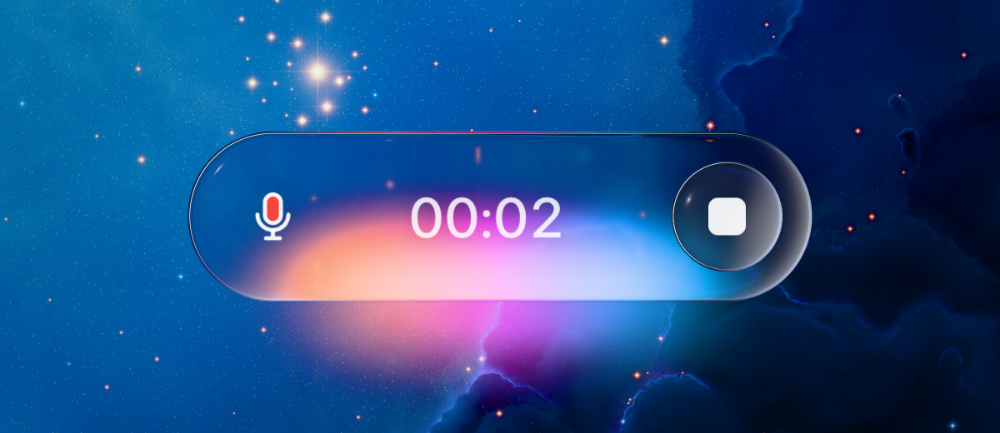

# Open Glass Recorder

**Voice, in orbit.** A browser voice-recorder experiment with two clearly separated implementations:

- **Approved reference demo**: restores the earlier recovered rendering engine, circular glass surround, raised inner lens, pointer deformation and audio-reactive recording animation. The recovered engine has separate third-party rights; see [THIRD_PARTY.md](THIRD_PARTY.md).
- **Independent MIT component**: the freshly written vanilla JavaScript/WebGL2 implementation remains available in `src/recorder.js`, the independent demo, lab and minimal composer example.

[Approved demo](https://himanshuchawla0807-gif.github.io/open-glass-recorder/) · [Chat example](https://himanshuchawla0807-gif.github.io/open-glass-recorder/examples/chat/) · [Independent demo](https://himanshuchawla0807-gif.github.io/open-glass-recorder/independent.html)

## Recorder states

**Idle**


**Recording — audio-reactive color**



Both states use the same scale and Blue Nebula background, with a smaller presentation and more space around the component.

## Why I built this

I saw a liquid-glass voice recorder shared on Twitter/X. It was a paid component, and I wanted to explore how the effect worked and build a free alternative. I used [REA](https://github.com/morluto/rea) to investigate the publicly delivered site, with help from Codex and Playwright.

The work produced a local recovery of the delivered renderer and a separate implementation written fresh. The earlier local rendering was preferred during visual review, so the default demo now exposes that reference rendering with new wallpaper, interface and integration code. The independent MIT alternative remains separately accessible. The reference renderer is not claimed as my original creation or relicensed as MIT.

Inspiration and reference engine: [Whitespace's Liquid Glass Recorder](https://experiments.thisiswhitespace.com/liquid-glass-recorder). No specific tweet URL was recorded. No affiliation or endorsement is implied.

## Approved demo and chat

The default demo restores the circular outer glass and raised mic lens. Recording expands the surround into a pill with a timer, stop control and audio-reactive glow. The clickable target remains the same diameter through the transition. The page uses three supplied space wallpapers and supports local recording, playback and downloads.

The chat example embeds the same reference renderer directly into its composer with a navy gradient sampled inside the glass and transparency outside it. Chat replies are local, rule-based placeholders; there is no AI service, transcription or audio upload. Text history persists in browser storage. Audio lives only in the tab.

The full reference-renderer demo is source-available with **unverified application-specific reuse rights**, not an entirely MIT/open-source component. See [license boundaries](THIRD_PARTY.md). For MIT-licensed reusable code, use the independent implementation below.

## Run locally

Requires Node.js 22 or later. No dependencies to install.

```sh
git clone https://github.com/himanshuchawla0807-gif/open-glass-recorder.git
cd open-glass-recorder
npm start
```

Open **http://localhost:8765**. If that port is busy: `PORT=8767 npm start`.

Microphone capture requires HTTPS or localhost and a browser that supports MediaRecorder. The optical effect needs WebGL2; other browsers receive a CSS glass button.

## Use the independent MIT component

```html
<div id="voice" style="width: 440px; height: 220px"></div>
<script type="module">
  import { GlassRecorder } from './src/recorder.js';

  const recorder = new GlassRecorder(document.querySelector('#voice'), {
    backdrop: './assets/blue-nebula.jpg',
    transparent: true,
    idleWidth: 210,
    recordingWidth: 330,
    radius: 56,
    skyTop: '#234674',
    skyBottom: '#070f24',
    glassTint: '#0c2853'
  });

  recorder.addEventListener('recording', ({ detail }) => {
    // detail.blob, detail.duration (seconds), detail.mimeType
    console.log(detail.blob);
  });
  recorder.addEventListener('error', ({ detail }) => {
    console.warn(detail.message);
  });

  // When your view unmounts:
  // recorder.destroy();
</script>
```

Call `recorder.configure({ idleWidth: 240, glassTint: '#392455' })` to change a variant live. `getConfiguration()` returns the normalized settings. Invalid colors throw a `TypeError`; numeric sizes are clamped to safe bounds.

| Option | Default | Meaning |
|---|---|---|
| `radius` | 56 | Button radius before responsive fitting |
| `idleWidth` | 168 | Resting pill width |
| `recordingWidth` | 340 | Expanded pill width |
| `maxScale` | 1.25 | Maximum scale in the host |
| `skyTop` | `#243d6b` | Top color when no image is loaded |
| `skyBottom` | `#060c1a` | Bottom gradient color |
| `glassTint` | `#071c43` | Glass material tint |
| `transparent` | false | Hide pixels outside the glass |
| `reducedMotion` | system preference | Skip the spring transition |

The component fits its largest state once. Starting, waiting for permission and recording do not recalculate a smaller button.

`transparent: true` hides the canvas outside the glass shape. The supplied backdrop remains the optical sample inside the glass. The renderer does not capture or refract arbitrary live HTML behind it.

| API | Purpose |
|---|---|
| `start()` | Request the mic and begin capture; duplicate starts are ignored |
| `stop()` | Finish a recording; results arrive through the `recording` event |
| `toggle()` | Start or stop |
| `setBackdrop(url)` | Load a same-origin or CORS-enabled image |
| `destroy()` | Release microphone, audio context, WebGL resources and listeners |
| `configure(options)` | Update dimensions, colors and display options live |
| `getConfiguration()` | Read the normalized configuration |
| `state` | `idle`, `requesting`, `recording`, or `stopping` |

Events: `statechange`, `recording`, `error`, `backdropchange`, `rendererfallback`, `configurationchange`.

## Project structure

```text
src/recorder.js   DOM, WebGL and recording lifecycle
src/shaders.js    Original fullscreen optical shader
src/math.js       Spring, timer and error helpers
src/demo.js       Independent demo playback and wallpapers
src/reference-demo.js  Approved reference-renderer integration
vendor/reference-recorder/  Recovered third-party renderer; separate rights
examples/chat/   Approved inline chat integration
src/lab.js        Three working component variants
src/lab-controls.js  Interactive inspector and config export
src/lifecycle.js  Safe cleanup for cached/unloaded pages
examples/        Inline composer integration
assets/          User-supplied demo wallpapers, separately licensed
```

## Checks

```sh
npm test
npm run check
```

See [TESTING.md](TESTING.md) for automated and browser verification, and [RESEARCH.md](docs/RESEARCH.md) for evidence boundaries. Tests are not a claim of all-device compatibility or complete branch coverage.

## License

Only the independently written code is [MIT licensed](LICENSE). Recovered files in `vendor/reference-recorder/` are excluded; see [THIRD_PARTY.md](THIRD_PARTY.md). Wallpapers and screenshots depicting them are excluded from that software license; see [asset notices](assets/NOTICE.md). Swap in images you have permission to use when redistributing or deploying a derivative demo.
