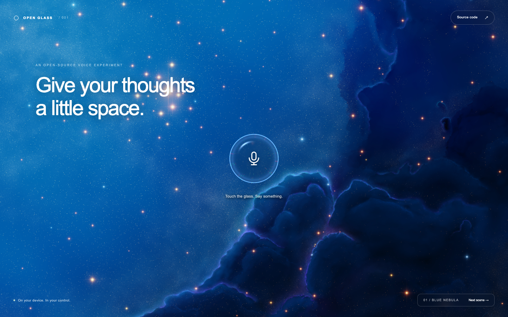
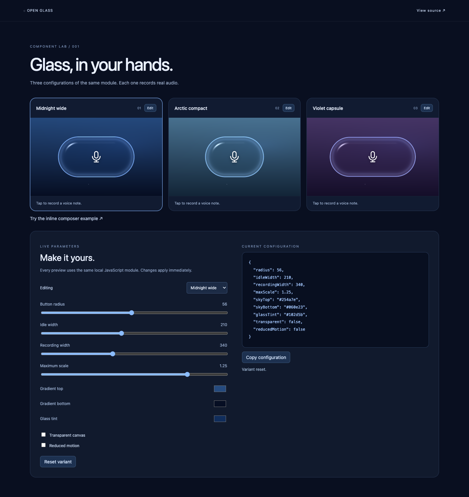

# Open Glass Recorder

**Voice, in orbit.** An independently written liquid-glass voice recorder in vanilla JavaScript and WebGL2. No framework, package installation, cloud service or API key required.

[Component lab](https://himanshuchawla0807-gif.github.io/open-glass-recorder/lab.html) · [Inline example](https://himanshuchawla0807-gif.github.io/open-glass-recorder/examples/composer.html) · [Try the demo](https://himanshuchawla0807-gif.github.io/open-glass-recorder/) · [How it was built](docs/RESEARCH.md) · [Component API](#use-the-component)



## Why I built this

I saw a liquid-glass voice recorder shared on Twitter/X. The original was sold as a paid component, and I wanted a free, reusable alternative. I used [REA](https://github.com/morluto/rea) to investigate the publicly delivered site, with help from Codex for implementation and Playwright for browser checks.

That investigation started with a local recovery of the public build. This open-source repository takes a different step: the JavaScript, shaders, UI and recording lifecycle here were written fresh for this project. It does **not** distribute the original commercial bundle, its shaders, branding, fonts, payment links or assets. This is an independent interpretation of the interaction, not a pixel-identical copy or the original author's source code.

Inspiration: [Whitespace's Liquid Glass Recorder](https://experiments.thisiswhitespace.com/liquid-glass-recorder). No specific tweet URL was recorded. The inspiration reference is credit, not an affiliation or license for the original product.

## What it does

- A wider refractive glass pill expands while recording, keeping its button diameter fixed.
- Spring motion, pointer attraction, chromatic fringes and microphone-reactive color.
- Actual microphone capture, local playback and downloadable audio files.
- Three landscape wallpapers supplied from my wallpaper collection.
- Responsive layouts, keyboard-operable buttons, reduced-motion support and a CSS fallback when WebGL2 is unavailable.
- Microphone tracks stop after recording; audio is never uploaded by this demo.

Voice notes live in the current tab. Download anything you want to keep before closing it.

## Component variants



The lab has three functional variants plus live width, radius, gradient, tint, transparency and motion controls. Copy the configuration and use it in another view. Run `npm run lab` to serve it separately at http://localhost:8768. The main demo remains at http://localhost:8765.

## Run locally

Requires Node.js 22 or later. No dependencies to install.

```sh
git clone https://github.com/himanshuchawla0807-gif/open-glass-recorder.git
cd open-glass-recorder
npm start
```

Open **http://localhost:8765**. If that port is busy: `PORT=8767 npm start`.

Microphone capture requires HTTPS or localhost and a browser that supports MediaRecorder. The optical effect needs WebGL2; other browsers receive a CSS glass button.

## Use the component

```html
<div id="voice" style="width: 440px; height: 220px"></div>
<script type="module">
  import { GlassRecorder } from './src/recorder.js';

  const recorder = new GlassRecorder(document.querySelector('#voice'), {
    backdrop: './assets/blue-nebula.jpg',
    transparent: true,
    idleWidth: 210,
    recordingWidth: 330,
    radius: 56,
    skyTop: '#234674',
    skyBottom: '#070f24',
    glassTint: '#0c2853'
  });

  recorder.addEventListener('recording', ({ detail }) => {
    // detail.blob, detail.duration (seconds), detail.mimeType
    console.log(detail.blob);
  });
  recorder.addEventListener('error', ({ detail }) => {
    console.warn(detail.message);
  });

  // When your view unmounts:
  // recorder.destroy();
</script>
```

Call `recorder.configure({ idleWidth: 240, glassTint: '#392455' })` to change a variant live. `getConfiguration()` returns the normalized settings. Invalid colors throw a `TypeError`; numeric sizes are clamped to safe bounds.

| Option | Default | Meaning |
|---|---|---|
| `radius` | 56 | Button radius before responsive fitting |
| `idleWidth` | 168 | Resting pill width |
| `recordingWidth` | 340 | Expanded pill width |
| `maxScale` | 1.25 | Maximum scale in the host |
| `skyTop` | `#243d6b` | Top color when no image is loaded |
| `skyBottom` | `#060c1a` | Bottom gradient color |
| `glassTint` | `#071c43` | Glass material tint |
| `transparent` | false | Hide pixels outside the glass |
| `reducedMotion` | system preference | Skip the spring transition |

The component fits its largest state once. Starting, waiting for permission and recording do not recalculate a smaller button.

`transparent: true` hides the canvas outside the glass shape. The supplied backdrop remains the optical sample inside the glass. The renderer does not capture or refract arbitrary live HTML behind it.

| API | Purpose |
|---|---|
| `start()` | Request the mic and begin capture; duplicate starts are ignored |
| `stop()` | Finish a recording; results arrive through the `recording` event |
| `toggle()` | Start or stop |
| `setBackdrop(url)` | Load a same-origin or CORS-enabled image |
| `destroy()` | Release microphone, audio context, WebGL resources and listeners |
| `configure(options)` | Update dimensions, colors and display options live |
| `getConfiguration()` | Read the normalized configuration |
| `state` | `idle`, `requesting`, `recording`, or `stopping` |

Events: `statechange`, `recording`, `error`, `backdropchange`, `rendererfallback`, `configurationchange`.

## Project structure

```text
src/recorder.js   DOM, WebGL and recording lifecycle
src/shaders.js    Original fullscreen optical shader
src/math.js       Spring, timer and error helpers
src/demo.js       Wallpaper selection, audio playback and downloads
src/lab.js        Three working component variants
src/lab-controls.js  Interactive inspector and config export
src/lifecycle.js  Safe cleanup for cached/unloaded pages
examples/        Inline composer integration
assets/          User-supplied demo wallpapers, separately licensed
```

## Checks

```sh
npm test
npm run check
```

See [TESTING.md](TESTING.md) for automated and browser verification, and [RESEARCH.md](docs/RESEARCH.md) for evidence boundaries. Tests are not a claim of all-device compatibility or complete branch coverage.

## License

The independently written code is [MIT licensed](LICENSE). Wallpapers and screenshots depicting them are excluded from that software license; see [asset notices](assets/NOTICE.md). Swap in images you have permission to use when redistributing or deploying a derivative demo.
